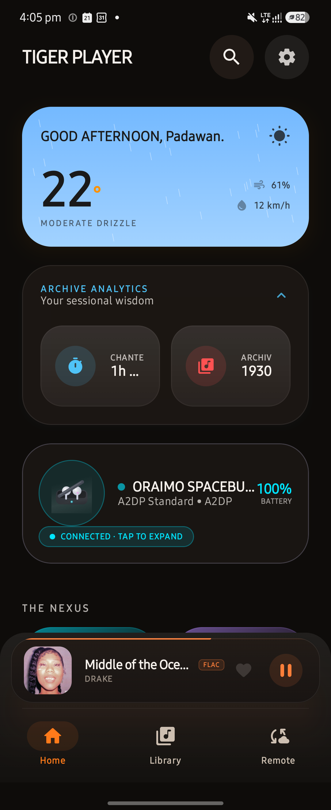
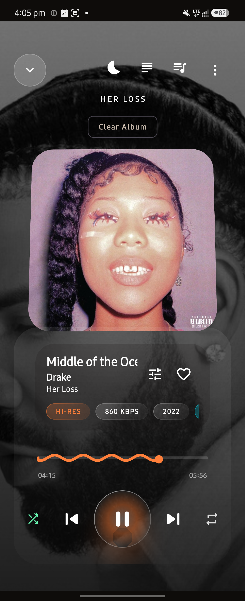
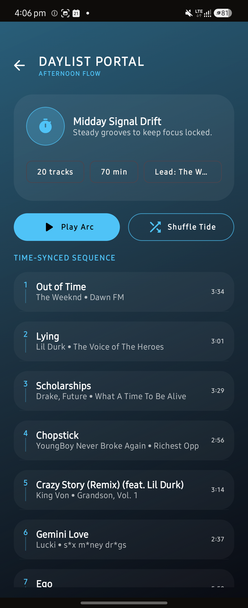
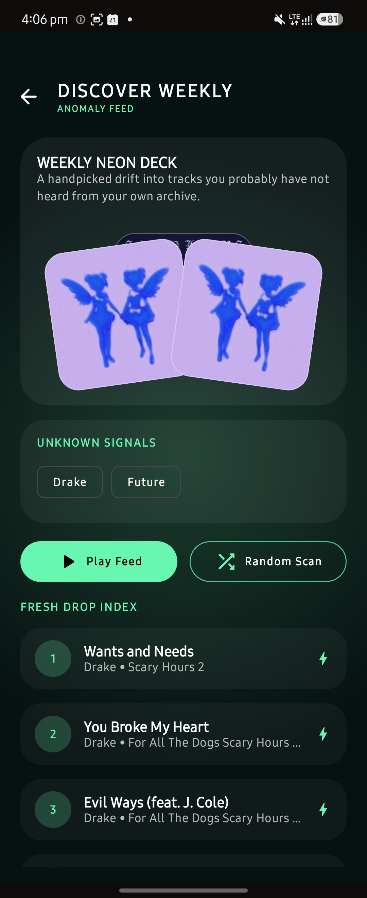
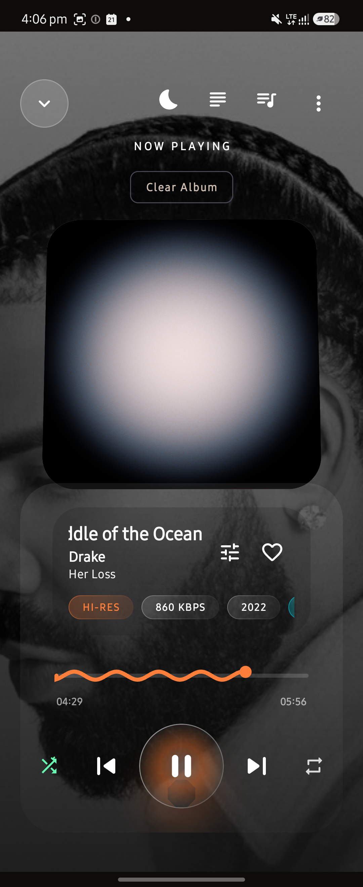
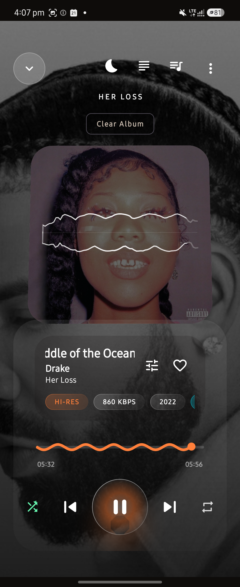
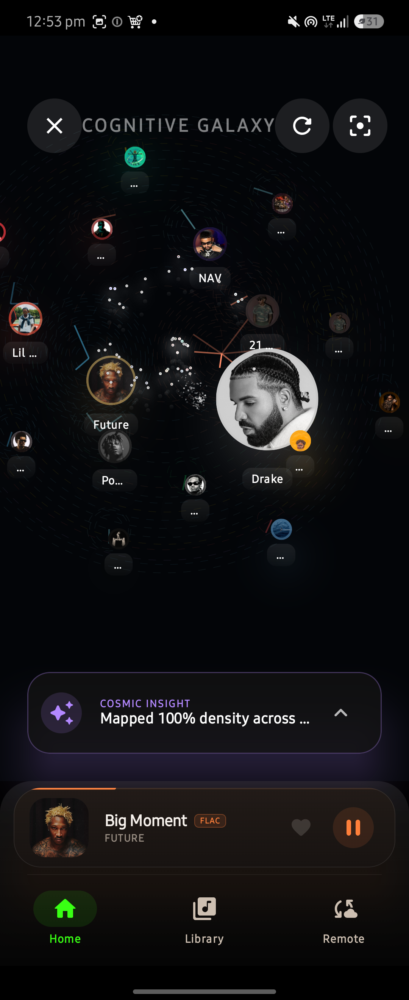
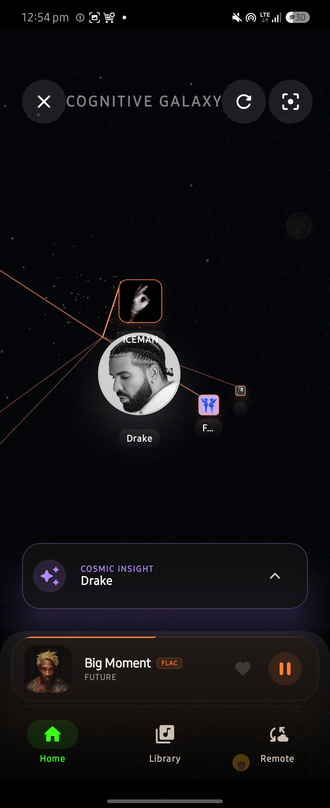

# TigerPlayer 🐅🐺

[](https://github.com/tyejaedon/TigerPlayer/releases/tag/v2.2.0-beta.13)
[](https://github.com/tyejaedon/TigerPlayer/actions/workflows/android-ci.yml)
[](https://kotlinlang.org/)
[-3DDC84?style=for-the-badge&logo=android&logoColor=white)](https://developer.android.com/)
[](LICENSE)

A high-fidelity, audiophile-grade Android music player unifying **local offline audio**, **Spotify streaming**, **5,000+ AutoEq headphone profiles**, **real-time GPU fluid visualizers**, and **flip-phone cover screen playback** in an electrifying neon aesthetic.

Built with **Kotlin**, **Jetpack Compose**, **AndroidX Media3**, **Room**, **Hilt**, and **OpenGL ES**.

---

## 🔥 Latest Release: v2.2 Beta Candidate (`v2.2.0-beta.13`)

The **v2.2 Parity & Audiophile Milestone** is now in public beta testing! Pre-built, cryptographically signed APKs are available for immediate sideloading:

| Edition | Description | Direct Download |
|:---|:---|:---|
| 🎵 **Full Edition** | Complete feature suite: Local Library + Spotify App Remote + Online Lyrics | [Download Full Signed APK (`v2.2.0-beta.13`)](https://github.com/tyejaedon/TigerPlayer/releases/download/v2.2.0-beta.13/TigerPlayer-2.2.0-beta.13-full-signed.apk) |
| 🛡️ **FOSS Edition** | 100% Free & Open Source: zero proprietary binaries, zero tracking, zero API keys required | [Download FOSS Signed APK (`v2.2.0-beta.13`)](https://github.com/tyejaedon/TigerPlayer/releases/download/v2.2.0-beta.13/TigerPlayer-2.2.0-beta.13-foss-signed.apk) |

> 📦 **Play Store Bundle & Checksums:** View signed Android App Bundles (`.aab`), SHA-256 digests, and the SPDX Software Bill of Materials on the [GitHub Release Candidate Page](https://github.com/tyejaedon/TigerPlayer/releases/tag/v2.2.0-beta.13).

---

## ✨ Highlights

- 🎵 **Dual Playback Engine**: Unified playback for local library (Media3 / ExoPlayer) and Spotify (Spotify App Remote).
- 📜 **Synchronized Lyrics Engine**: Smooth centered auto-scrolling, tap-a-line seeking, `.lrc` companion files, and embedded metadata.
- 🎧 **Audio Devices Hub & AutoEq**: One-tap parametric frequency compensation across 5,000+ headphones, Bluetooth codec badges, and per-device preset persistence.
- 🎛️ **Audiophile DSP & True-Peak Limiter**: Bit-perfect lossless passthrough with zero-overshoot look-ahead limiting and automated headroom protection.
- 📁 **Lossless M3U / M3U8 Playlist Engine**: Full SAF import/export supporting relative/absolute paths, UTF-8 BOM, and directives.
- 🌊 **Harmonized Waveform & Cinematic Fluid Vortex**: 3-tier harmonic wave seeker bar with live neon extraction, 120 FPS zero-allocation render loop, and interactive fluid vortex background mode.
- 📱 **Flip-Phone Cover Screen Experience**: Dedicated outer display UI (Galaxy Z Flip, Motorola Razr) featuring a 3D cylindrical playlist wheel and double-tap liking.
- 🧠 **On-Device Music Discovery**: Smart Day List, Discovery Weekly, and Sonic Footprint calculated 100% locally on-device.

---

## 🌟 What's New in v2.2

### 📜 Synchronized Lyrics with Interactive Auto-Scroll
- **Live Auto-Scroll:** Fluid, centered scrolling following track progression with smooth anticipation and intro-guards.
- **Interactive Seek:** Tap any lyrical line to seek playback directly to that timestamp.
- **Embedded & Companion Support:** Prefers embedded ID3 (`USLT`/`SYLT`) and FLAC Vorbis tags, or companion `.lrc` sidecar files in the local directory.
- **Dual Remote Fallback:** Silent background lookup via **Kugou** and **LRCLIB** APIs when local lyrics are unavailable.
- **Manual Timing Offset:** Calibrate lyric synchronization on-the-fly with granular `±0.5s` nudging.

### 🎧 Audio Devices Hub & AutoEq Headphone Profiling
- **AutoEq Database Integration:** Search over 5,000 measured headphone and in-ear monitor curves (Harman, Crinacle, Rtings, Oratory1990) and apply calibrated parametric frequency corrections with a single tap.
- **Per-Device Presets:** Automatic EQ profile switching when connecting Phone Speakers, Wired Headphones, or Bluetooth endpoints.
- **Hardware Telemetry:** Live Bluetooth codec detection badge (LDAC, aptX HD, AAC, SBC) and listening metrics tracking.
- **Custom Wired Profiles:** Create and name custom analog hardware profiles for reference studio monitors and IEMs.

### 🌊 Harmonized Waveform Seeker & Cinematic Fluid Vortex
- **Harmonized Wave Seeker (`FieryWavySeeker`):** 3-tier harmonic wave hierarchy with unconfined apex amplitude, tabular monospace timestamps, and non-destructive drag seeking.
- **Cinematic Fluid Vortex:** Tap the album artwork card to toggle between pristine artist artwork and a real-time GPU fluid vortex visualizer with a smooth 400ms crossfade.
- **Zero-Allocation 120 FPS Loop:** Optimized OpenGL ES rendering with pre-allocated uniform caches and half-float (FP16) textures to conserve battery and eliminate frame drops.
- **Ambient Breathing Swirl:** Subtle dynamic motion keeps the visualizer alive even when idle or paused.

### 🎛️ Audiophile True-Peak Limiting & Auto-Headroom
- **Transparent True-Peak Limiter:** Complete removal of harsh 0.82f AGC dynamic compression; lossless audio (FLAC, WAV, ALAC, AIFF, 24-bit Hi-Res) passes through untouched with bit-perfect fidelity.
- **Auto-Headroom Calculation:** Precise composite filter peak detection (`BiquadDesigner`) ensures parametric EQ boost never clips or distorts analog outputs.

### 📁 Lossless M3U / M3U8 Playlist Engine
- **SAF Lossless Import & Export:** Lossless parsing and writing of M3U and M3U8 playlists via Android's Storage Access Framework.
- **Robust Character Handling:** Full UTF-8 support with Byte Order Mark (BOM) handling, Unix/Windows directory separator normalization, and detailed unmatched-item import reports.

### 📱 Flip Phone Cover Screen Experience
- **Dedicated Outer Display UI:** Custom-tailored layouts for secondary outer screens (Samsung Galaxy Z Flip series, Motorola Razr).
- **3D Cylindrical Playlist Carousel:** Smooth gesture-driven 3D wheel for rapid playlist selection.
- **Double-Tap Quick Like:** Double-tap cover display artwork to instantly favorite songs with an animated neon heart.
- **Full TalkBack Accessibility:** Complete gesture instructions localized across English, German, Spanish, French, and Japanese.

---

## 📸 Screenshots

| Home                          | Player                            | Day List                             |
|-------------------------------|-----------------------------------|--------------------------------------|
|  |  |  |

| Discover Weekly                                     | Fluid Visualizer                                     | Waveform Visualizer                                         |
|-----------------------------------------------------|------------------------------------------------------|-------------------------------------------------------------|
|  |  |  |

| Galaxy View (Full)                                       | Galaxy View (Artist)                                         | Sonic Footprint                                             |
|-----------------------------------------------------------|----------------------------------------------------------------|-------------------------------------------------------------------|
|  |  |  |

---

## 🚀 Core Features

### Dual Playback Engine
TigerPlayer unifies local music playback and Spotify streaming into one unified, uninterrupted queue:
- Local offline audio playback via AndroidX Media3 / ExoPlayer.
- Remote Spotify streaming via Spotify App Remote SDK.
- Shared queue management, lock screen controls, and system notification media sessions.

### Smart On-Device Discovery
Personalized listening recommendations generated entirely on-device without cloud profiling or telemetry:
- **Day List:** Dynamically adapts playlist recommendations based on listening habits and time of day.
- **Discovery Weekly:** Resurfaces forgotten gems from your personal library.
- **Heavy Rotation:** Real-time tracking of top tracks, artists, and genres.
- **Sonic Footprint:** Hexagonal radar analytics visualizing acoustic, electronic, bass-heavy, vocal, and atmospheric listening tendencies.

### Fluid & Waveform Visualizers
A state-of-the-art GPU-accelerated graphics engine running at up to 120 FPS:
- Audio-reactive Navier-Stokes fluid simulations rendered via custom GLSL fragment shaders.
- Dynamic color palette extraction based on active album artwork.
- Bloom, ripple, and ACES tone mapping passes.
- Modal-aware and lifecycle-aware GPU suspension when hidden or backgrounded.

---

## 🏗️ Architecture

TigerPlayer follows **Clean Architecture** and **MVVM** with **Unidirectional Data Flow (UDF)** powered by Kotlin Coroutines and StateFlow.

```text
UI Layer (Jetpack Compose)
        │
        ▼
ViewModel Layer (StateFlow & UI State)
        │
        ▼
Domain Engine Layer (@Inject Plain Classes)
  ├── PlaybackEngine          ├── LibraryEngine
  ├── AdaptiveDspEngine       ├── StatsEngine
  ├── WaveformEngine          ├── MetadataEngine
  ├── AudioDeviceEngine       └── FluidRenderEngine
        │
        ▼
Repository Layer (@Singleton Data Access)
  ├── AudioRepository         ├── AudioDeviceRepository
  ├── LyricsRepository        ├── M3uRepository
  ├── HistoryRepository       └── SpotifyRepository
        │
        ▼
Data Sources & Audio HAL
  ├── Room Database (TigerDatabase)
  ├── Android MediaStore / SAF
  ├── AndroidX Media3 (AudioPlayerService)
  ├── Subsonic / Navidrome REST API
  └── Spotify App Remote IPC
```

---

## 🛠 Tech Stack

| Layer | Technologies |
|:---|:---|
| **Language** | Kotlin 2.2.20 |
| **UI Framework** | Jetpack Compose (Material 3 + Custom Neon Design System) |
| **Audio Core** | AndroidX Media3 1.5.x / ExoPlayer, Custom AudioProcessors |
| **DSP Engine** | State Variable Filters (SVF), Linkwitz-Riley Crossovers, Schroeder Reverb, True-Peak Limiter |
| **Headphone EQ** | AutoEq Database (5,000+ Parametric Curves), Biquad Filter Design |
| **Graphics** | OpenGL ES 3.0 / 3.2, GLSL Shaders, Texture Ping-Pong Passes |
| **Dependency Injection** | Hilt (KSP) |
| **Local Persistence** | Room (SQLite with full schema migrations), DataStore Preferences |
| **Networking** | Retrofit 2, OkHttp 3, Gson |
| **Image Loading** | Coil |
| **Build & Toolchain** | Gradle 9.x, AGP 9.5.0, Version Catalog (`libs.versions.toml`), JDK 17 |

---

## 🔑 Setup & Build

TigerPlayer ships two distribution flavors:
- **`foss`** — Completely open-source build with zero proprietary dependencies, zero tracking, and no Spotify App Remote dependency. This is the official build submitted to F-Droid.
- **`full`** — The full-featured build including Spotify App Remote playback.

### Optional `secrets.properties`
Create a `secrets.properties` file in the project root if you wish to configure third-party cloud integrations (optional — builds succeed without it and use placeholder values):

```properties
SPOTIFY_CLIENT_ID=your_spotify_client_id
LASTFM_API_KEY=your_lastfm_api_key
YOUTUBE_API_KEY=your_youtube_api_key
```

> **Note:** Spotify authentication uses Authorization Code with PKCE. No Spotify client secret is ever required, stored, or bundled into the application.

### Build Commands

```bash
# Assemble FOSS Debug APK (no API keys or proprietary binaries required)
./gradlew :app:assembleFossDebug

# Assemble Full Debug APK (with Spotify App Remote)
./gradlew :app:assembleFullDebug

# Assemble Sideloadable Release APKs
./gradlew :app:assembleFossRelease :app:assembleFullRelease

# Run Quality Gate Checks (JVM Unit Tests & Android Lint)
./gradlew :app:lintFossDebug :app:lintFullDebug
./gradlew :app:testFossDebugUnitTest :app:testFullDebugUnitTest
```

---

## 🤝 Contributing & Issue-First Protocol

Contributions, bug reports, and feature proposals are welcome! 

TigerPlayer strictly adheres to the **Issue-First Protocol (AIRP)**:
1. Every code change must trace back to a formal GitHub issue with acceptance criteria and a milestone.
2. Direct pushes to `master` are disabled. All changes land via scoped pull requests (`fix/issue-<ID>-<slug>` or `feat/issue-<ID>-<slug>`).
3. Changes must pass the full quality toolchain (`lint`, JVM unit tests, and `assembleDebug`).
4. User-facing changes must include an entry in [`CHANGELOG.md`](CHANGELOG.md) under `[Unreleased]`.

See [`CONTRIBUTING.md`](CONTRIBUTING.md) and [`.github/instructions/AGENT-WORKFLOW-CHECKLIST.md`](.github/instructions/AGENT-WORKFLOW-CHECKLIST.md) for full contributor guidelines.

---

## 📝 Documentation & Changelog

- [`CHANGELOG.md`](CHANGELOG.md) — Running record of all user-visible and engineering changes.
- [`docs/Beta-Pipeline-and-Release-Process.md`](docs/Beta-Pipeline-and-Release-Process.md) — Pre-production beta architecture, versioning formulas, and signing workflows.
- [`docs/Roadmap-v2.1.1-v2.3.md`](docs/Roadmap-v2.1.1-v2.3.md) — Release milestones, issue index, and parity tracker.
- [`docs/architecture/`](docs/architecture/) — PlantUML diagrams and deep-dive compartment specifications.

---

## ❤️ Credits

Created by **Jaedon** in Nairobi, Kenya.

TigerPlayer is an open exploration of audiophile sound reproduction, intelligent on-device music discovery, accessible user experience, and real-time graphics on Android.
