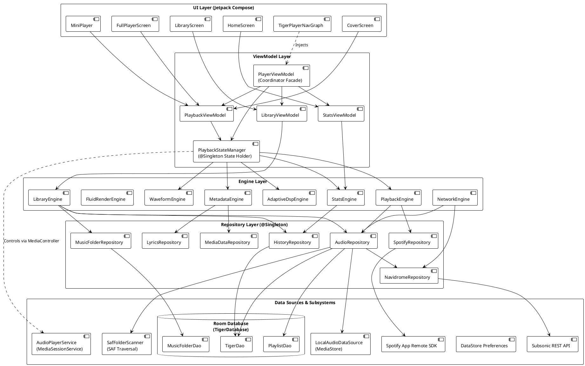
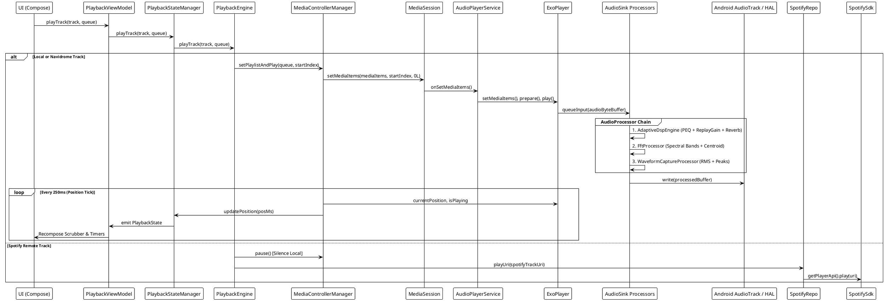
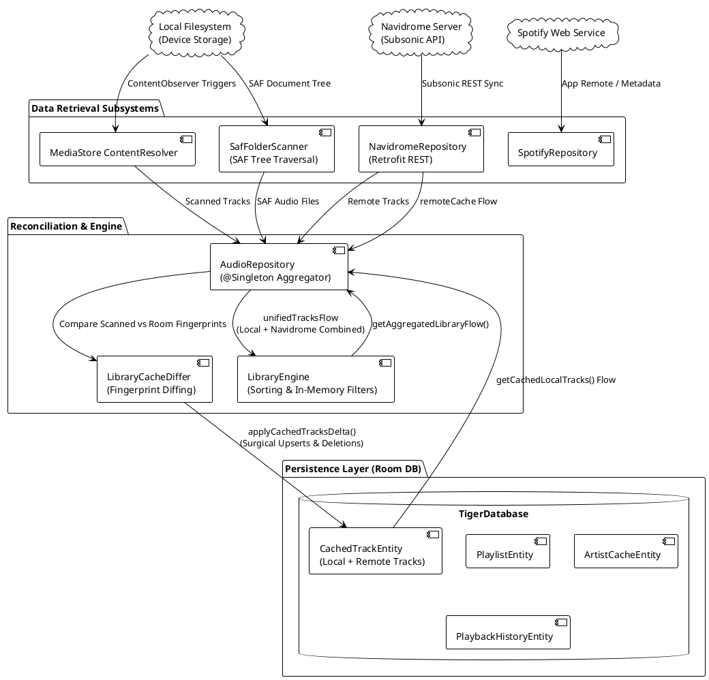
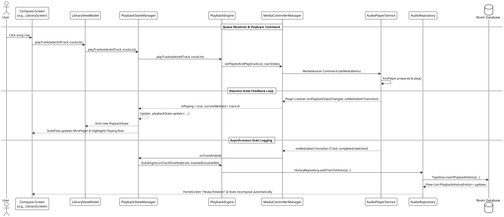

# TigerPlayer Architectural Design Guide

This document is the authoritative technical specification and architectural reference for the TigerPlayer Android music player. It details subsystem boundaries, data synchronization models, the Media3 audio pipeline, and state flow invariants.

---

## 1. Architectural Philosophy & Layered Structure

TigerPlayer enforces a strict unidirectional, five-layer software architecture:

```
UI (Jetpack Compose)
       │
       ▼
  ViewModel (State Holders & Coordinators)
       │
       ▼
    Engine (Pure Domain Orchestration)
       │
       ▼
  Repository (Single Source of Truth & Caching)
       │
       ▼
Data Sources / DAOs / Remote APIs / Hardware Subsystems
```

### Layer Boundary Rules

1. **UI Layer (`ui/`, `navigation/`)**:
   - Built exclusively with Jetpack Compose.
   - Declarative and stateless; composables accept state objects and hoist events via lambdas.
   - Never interact directly with Engines, Repositories, or Data Sources.
   - Communicates solely with ViewModels.

2. **ViewModel Layer (`ui/player/`, `ui/library/`, `ui/home/`)**:
   - Exposes immutable reactive streams (`StateFlow<T>`, `SharedFlow<T>`).
   - Translates domain flows into presentation-ready state models.
   - Scoped to feature lifecycles (`PlaybackViewModel`, `LibraryViewModel`, `StatsViewModel`).
   - Coordinates application-wide player state via `@Singleton PlaybackStateManager`.
   - Free of Android UI widget imports and non-Android framework domain logic.

3. **Engine Layer (`engine/`)**:
   - Plain `@Inject` domain orchestrators (pure Kotlin where feasible).
   - Contains business rules, math algorithms (DSP, FFT, fluid physics, scrobble qualification), and transport coordination.
   - Orchestrates one or more repositories and low-level service managers.
   - Never imports UI components or Compose runtime elements.

4. **Repository Layer (`data/repository/`)**:
   - Annotated with `@Singleton`; acts as the canonical single source of truth for all domain entities.
   - Manages caching policies, data diffing, in-memory buffering, and reconciliation between disk (Room) and remote sources.
   - All public methods exposing I/O operations are main-safe suspend functions or expose cold/hot Flows configured with `Dispatchers.IO`.

5. **Data Source / API / DAO Layer (`data/local/`, `data/source/`, `data/remote/`)**:
   - Low-level persistence (Room DAOs, DataStore Preferences, EncryptedSharedPreferences).
   - Hardware/OS readers (`LocalAudioDataSource` querying MediaStore, `SafFolderScanner` traversing Storage Access Framework).
   - Network API clients (Retrofit Subsonic/Navidrome interfaces, Spotify App Remote SDK bridge, Last.fm, LRCLIB).

---

### Layered Architecture Diagram



---

## 2. Media3 & Audio Playback Pipeline

TigerPlayer builds upon AndroidX Media3 (`MediaSessionService` + `ExoPlayer`), providing foreground audio playback, background survival, hardware offload management, and a real-time DSP/visualizer pipeline.

### Playback Architecture Components

1. **`AudioPlayerService` (`MediaSessionService`)**:
   - Manages the lifecycle of `ExoPlayer` and the underlying `MediaSession`.
   - Maintains the ongoing media playback foreground service notification with `MediaStyle`.
   - Handles audio focus transitions and transient focus loss (`AUDIOFOCUS_LOSS_TRANSIENT`).
   - Registers audio noisy receivers to pause when headphones or Bluetooth disconnect.
   - Manages audio offload transitions (`routeToSystemDecoderDsp`) with smooth volume fades (`VOLUME_RAMP_STEPS`) and hardware sink drain delays (`SINK_DRAIN_DELAY`).

2. **`MediaControllerManager`**:
   - Application-scoped bridge between the UI and `AudioPlayerService`.
   - Connects asynchronously via `SessionToken` to `MediaController`.
   - Serializes track queues into `MediaItem` extras using 18 metadata fields, ensuring queue state restoration without re-querying the library.
   - Drives periodic playback position ticks (250 ms) and background persistence (15 s intervals).

3. **Audio Processor Pipeline (`DefaultAudioSink`)**:
   ExoPlayer passes 32-bit floating point or 16-bit PCM audio frames through a linear chain of custom `AudioProcessor` implementations before delivery to Android HAL:

   ```
   ExoPlayer Audio Track
            │
            ▼
   ┌────────────────────────────────────────┐
   │ AdaptiveDspEngine                      │
   │ - Parametric EQ (SVF Filters)          │
   │ - ReplayGain Scaling & Peak Limiter   │
   │ - Acoustic Environment Simulation      │
   └────────────────────────────────────────┘
            │
            ▼
   ┌────────────────────────────────────────┐
   │ FftProcessor                           │
   │ - Windowing & Spectral FFT Analysis    │
   │ - 6-Band Audio-Reactive Energy Split   │
   └────────────────────────────────────────┘
            │
            ▼
   ┌────────────────────────────────────────┐
   │ WaveformCaptureProcessor               │
   │ - Real-Time Peak & RMS Audio Capture   │
   └────────────────────────────────────────┘
            │
            ▼
   Android AudioTrack / Audio HAL
   ```

4. **Samsung OEM Compatibility Guard**:
   - Samsung audio HALs can suffer buffer instability in float mode under heavy GPU visualizer loads.
   - `AudioPlayerService` detects Samsung devices at runtime (`Build.MANUFACTURER`) and forces 16-bit PCM output while allowing bit-perfect float output on other OEMs.

5. **Audio-Reactive Haptic Engine**:
   - `AudioPlayerService` observes spectral energy from `AdaptiveDspEngine` / `FftProcessor`.
   - Smooths bass and energy flux over time, triggering haptic pulses via Android `Vibrator` / `VibratorManager` when exceeding dynamic thresholds with strict cooldown guards.

---

### Media3 Playback Pipeline Diagram



---

## 3. Data Synchronization & Multi-Source Library Architecture

TigerPlayer unifies local storage, network-attached personal servers (Navidrome/Subsonic), and cloud streaming (Spotify) into a consolidated, searchable catalog.

### Ingestion & Convergence Pipeline

1. **Local MediaStore Source (`LocalAudioDataSource`)**:
   - Queries `MediaStore.Audio.Media.EXTERNAL_CONTENT_URI` with projected columns.
   - Hoists column index lookups outside cursor iterations for high-throughput scanning.
   - Monitors content changes via `ContentObserver` on the external audio URI with a 1.5-second debounce window to collapse batch filesystem events into a single incremental pass.

2. **Custom Storage Directories (`SafFolderScanner`, `MusicFolderRepository`)**:
   - Scans user-specified storage trees via Android Storage Access Framework (SAF).
   - Recursively traverses directories, parsing file headers and respecting `.nomedia` exclusion flags.
   - Persists allowed and excluded directory configurations in Room (`MusicFolderDao`).

3. **Navidrome Subsonic Integration (`NavidromeRepository`, `NetworkEngine`)**:
   - Connects to Subsonic-compliant servers via Retrofit.
   - Authenticates using dynamic salt + MD5 token generation (`NavidromeUrlSigner`), avoiding caching passwords or tokens in URIs.
   - Remote stream URIs use a clean internal scheme (`navidrome://<id>`); audio requests are dynamically intercepted and authenticated at streaming time via `ResolvingDataSource.Factory`.

4. **Incremental Differential Cache (`LibraryCacheDiffer`)**:
   - Instead of clearing and repopulating Room on library scans, `LibraryCacheDiffer` computes a fast fingerprint delta (`id`, `dateModified`, `size`).
   - Room updates execute atomically within a transaction (`applyCachedTracksDelta`), performing surgical upserts and deletions. This eliminates SQLite thrashing and UI jitter.

---

### Data Synchronization Flow Diagram



---

## 4. State & Event Flow (Unidirectional Data Flow)

TigerPlayer applies Unidirectional Data Flow (UDF) across all screens. State flows down through immutable `StateFlow` streams; user intents flow up via explicit function calls.

### State Management Invariants

1. **Single Source of Truth**:
   - `PlaybackStateManager` owns all playback state (`PlaybackState`).
   - Individual ViewModels (`PlaybackViewModel`, `LibraryViewModel`, `StatsViewModel`) derive specialized, immutable UI state models (`PlaybackUiState`, `LibraryUiState`, `HomeUiState`).

2. **Recomposition Decoupling**:
   - High-frequency position ticks (4 Hz) update `PlaybackState.currentPosition`.
   - UI components observing the library or analytics do not recompose during position ticks because state flows are strictly separated into discrete ViewModels.

3. **Main Safety & Concurrency**:
   - Suspend functions in Repositories and Engines use `withContext(Dispatchers.IO)` or `flowOn(Dispatchers.IO)`.
   - Room queries returning `Flow<T>` run on Room's background executor and emit downstream safely.
   - ViewModels consume flows on `viewModelScope` using `SharingStarted.WhileSubscribed(5_000)`.

---

### State and Event Flow Sequence Diagram



---

## 5. Threading, Concurrency, and Error Handling Guardrails

### Threading Architecture

| Layer | Dispatcher | Invariant |
|---|---|---|
| **UI (Compose)** | `Dispatchers.Main` | Immediate UI rendering; zero disk/network access. |
| **ViewModel** | `viewModelScope` (`Dispatchers.Main.immediate`) | State aggregation and UI event dispatching. |
| **Engine** | Configurable (`Dispatchers.Default` for math/DSP/sorting; `Dispatchers.IO` for storage coordination) | CPU-bound transforms offloaded from main thread. |
| **Repository** | `Dispatchers.IO` (`@IoDispatcher`) | Disk reads/writes, Room transactions, network I/O. Must be main-safe. |
| **Data Sources** | `Dispatchers.IO` | Room queries, MediaStore ContentResolver queries, HTTP calls. |

### Concurrency Rules

1. **Cancellation Integrity**:
   - Never swallow `CancellationException` in general `catch (e: Exception)` blocks.
   - Always rethrow `CancellationException` to allow coroutine cooperative cancellation.

2. **Mutex Scoping**:
   - Shared mutable state in `@Singleton` repositories (e.g., scan synchronization in `AudioRepository`) is protected via `kotlinx.coroutines.sync.Mutex`.
   - Never use blocking Java `synchronized` blocks inside coroutines unless guarding pure memory counters without suspend points.

3. **Audio Hardware Offload Transitions**:
   - Offload toggling (`routeToSystemDecoderDsp`) performs an asynchronous volume fade-down, pauses the hardware sink, drains audio buffers (`SINK_DRAIN_DELAY`), switches format, and ramps volume back up.
   - Guarded by `offloadTransitionMutex` to ensure mid-fade cancellations never leave the player in a muted state.


---

## 6. Compartment Documentation & PlantUML Specifications

TigerPlayer enforces the **`audio-pipeline-explainer`** documentation methodology across all core source packages:
- **Plain-English Conceptual Introductions:** Every module begins with an accessible explanation of its purpose and mental model for both newcomers and seasoned developers.
- **Inline Jargon Definitions:** Specialized terms (e.g. *PCM, SVF, HAL, AudioSink, AGSL*) are defined in place upon first appearance.
- **Tabulated Jargon Glossaries:** Each module concludes with a structured terminology table covering plain-English definition, pipeline role, and failure consequences.
- **Scope & Limitations Transparency:** Explicit documentation of thread boundaries, hardware quirk handling (e.g., Samsung HAL float bypass), and active technical debt.

### Dedicated PlantUML Architecture Models

Detailed, standalone PlantUML specifications are maintained in this directory:

| Diagram File | Description & Focus |
|---|---|
| [`system-compartments.puml`](./system-compartments.puml) | **Full System Compartments:** End-to-end component wiring across UI, ViewModel, Engine, Service, Repository, and Persistence layers. |
| [`audio-pipeline-lifecycle.puml`](./audio-pipeline-lifecycle.puml) | **AudioProcessor Pipeline & Offload Lifecycle:** Sequence flow from ExoPlayer decoders through `AdaptiveDspEngine`, `FftProcessor`, `WaveformCaptureProcessor`, to the Audio HAL, including the 4-phase mutex-guarded offload volume ramp. |
| [`data-convergence-architecture.puml`](./data-convergence-architecture.puml) | **Multi-Source Data Ingestion & Dual Transport:** Ingestion flow from Local MediaStore, Navidrome Subsonic, and Spotify Remote into Room DB, surfaced via `AudioRepository` and routed by `PlaybackEngine`. |

### Per-Module Compartment Guides

Each primary codebase folder provides a detailed compartment README:

- **[Domain Engine Compartment](../../app/src/main/java/com/tigerplayer/engine/README.md)**: Math algorithms, Cytotoxic SVF equalizers, Prism 3-stem Linkwitz-Riley crossovers, Schroeder hall reverberation, and look-ahead peak limiting.
- **[Service & Playback Runtime Compartment](../../app/src/main/java/com/tigerplayer/service/README.md)**: MediaSessionService lifecycle, ExoPlayer audio processor chain, volume ramp fading, dynamic Navidrome URL signing, and audio-reactive haptics.
- **[Data & Persistence Compartment](../../app/src/main/java/com/tigerplayer/data/README.md)**: Room database schema, Single Source of Truth repositories, DataStore preferences, Subsonic/Spotify remote APIs, and PKCE security.
- **[UI & Presentation Compartment](../../app/src/main/java/com/tigerplayer/ui/README.md)**: Jetpack Compose screens, MVI/StateFlow architecture, Arcane Glass design system, 60/120 FPS zero-allocation performance rules, and cover screen mini hubs.
